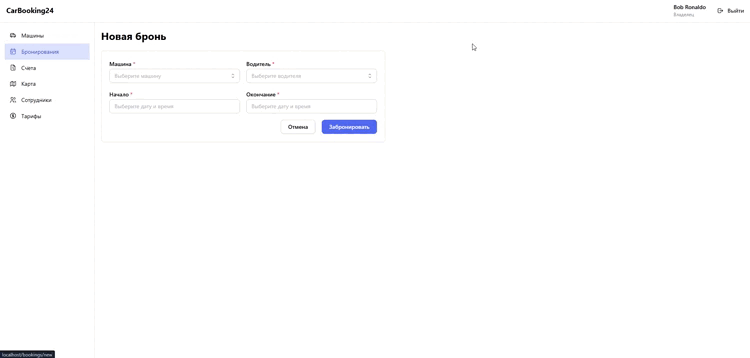

# CarBooking24 — бронирование и отслеживание корпоративных автомобилей

Система для компаний с собственным автопарком: сотрудники бронируют машины, менеджеры видят их на карте в реальном времени, а стоимость поездок рассчитывается автоматически. Микросервисный бэкенд на NestJS, фронтенд на React.

## :pencil: Описание

В компании с автопарком обычно приходится отвечать на одни и те же вопросы: какая машина сейчас свободна, где находится та, что уехала утром, сколько стоила поездка и не выехал ли водитель за пределы города. CarBooking24 собирает ответы в одном месте.

Компания регистрируется вместе с владельцем, заводит тарифы, машины и сотрудников. Менеджер бронирует машину на водителя и на время, водитель начинает поездку, и машина появляется на карте. По завершении поездки система сама считает стоимость по времени и пробегу, выставляет счёт и отправляет уведомление.


## :boom: Роли

| Роль | Что может |
|------|-----------|
|Владелец| управляет компанией, сотрудниками всех ролей, автопарком, бронированиями и тарифами |
|Администратор| создаёт менеджеров и водителей, управляет автомобилями и тарифами |
|Менеджер| бронирует автомобили для водителей, следит за машинами на карте |
|Водитель| просматривает список автомобилей компании, историю бронирования и счета на оплату |

## :wrench: Технологии
* Backend - Bun + NestJS + TypeScript + Prisma + Socket.IO
* Frontend - React + Vite + MobX + Leaflet + Mantine
* Web server - Nginx
* Database - PostgreSQL + PostGIS (расширение для геолокации)
* Message broker - RabbitMQ
* Containerization - Docker

## :file_folder: Архитектура

| Сервис | Отвечает за |
|---|---|
| **gateway** | единая точка входа: HTTP API, проверка JWT, WebSocket для карты |
| **fleet** | компании, сотрудники, машины, тарифы |
| **booking** | бронирования и их статусы |
| **telemetry** | GPS-точки, текущее положение машин, геозоны, расчёт пробега |
| **billing** | расчёт стоимости поездки, счета и оплата |
| **notification** | уведомления по почте и в Telegram |

Сервисы общаются через RabbitMQ: запросы от gateway и события между сервисами. У каждого сервиса своя база данных.

## :cactus: Возможности

**Автопарк**
- машины со статусами «доступна», «на обслуживании», «списана»;
- тарифы за минуту, за километр и за сутки, привязка тарифа к машине.

**Бронирования**
- бронь машины на водителя и период, с защитой от пересечений;
- начало и завершение поездки, отмена ещё не начатых броней;
- брони, которые так и не начали, автоматически переводятся в «не состоялась».

**Карта и телеметрия**
- положение машин обновляется на карте в реальном времени через WebSocket;
- пробег поездки считается по GPS-точкам;
- геозоны: администратор рисует область на карте и получает уведомление, если машина её покидает.

**Счета**
- стоимость поездки: минуты × ставка за минуту + километры × ставка за километр;
- в счёте сохраняется тариф на момент поездки, поэтому смена тарифа не меняет старые счета.

**Уведомления** — об оплате и о выезде за геозону, по почте и в Telegram.

**Симулятор** — отдельная программа, которая входит под водителями и двигает их машины по маршрутам, чтобы систему можно было увидеть в работе.


## Демонстрация



## :rocket: Установка и запуск

### Требования

- [Docker Desktop](https://www.docker.com/products/docker-desktop/)
- Git


### 1. Клонируйте репозиторий
```bash
git clone https://github.com/selli73/Tracking-of-Corporate-Vehicles.git
cd Tracking-of-Corporate-Vehicles
```

### :lock: 2. Создайте файлы окружения

Файлы `.env` не хранятся в репозитории. Создайте их из примеров, выполнив команды из корня проекта:

```bash
cp .env.example .env
cp backend/.env.example backend/.env
cp simulator/.env.example simulator/.env
cp simulator/credentials.example.json simulator/credentials.json
```

| Файл | Для чего |
|---|---|
| `.env` | логины и пароли PostgreSQL и RabbitMQ |
| `backend/.env` | адреса баз данных, RabbitMQ, секрет JWT, данные для почты и Telegram |
| `simulator/.env` | адреса API для симулятора |

### 3. Запустите проект

```bash
docker compose up --build
```

### 4. Первые шаги

1. Зарегистрируйте компанию на странице регистрации.
2. Создайте тариф, машину и одного-двух водителей.
3. Впишите почты и пароли водителей в `simulator/credentials.json` (пример — `credentials.example.json`) и перезапустите симулятор:
   ```bash
    docker compose restart simulator
   ```
4. Создайте бронь на водителя и начните поездку: машина поедет по карте.
5. Завершите поездку: появится счёт с рассчитанной стоимостью.


## :book: Документация API

После запуска проекта документация Swagger доступна по адресу:
`http://localhost/api/docs`


## :slightly_smiling_face: Об авторе

CarBooking24 — моя реализация микросервисной системы с событийным взаимодействием, геоданными и обновлениями в реальном времени: от проектирования сервисов до запуска одной командой в Docker.

### Ключевые решения

- **Идемпотентные обработчики событий.** RabbitMQ доставляет сообщения «хотя бы один раз», поэтому повторное событие не создаёт второй счёт: это гарантирует уникальный индекс в базе.
- **Снимок тарифа в счёте.** Изменение цен не переписывает историю поездок.
- **Карта в реальном времени.** Координаты идут через WebSocket с разделением по компаниям, а при переподключении карта сама подтягивает актуальное состояние.
- **Единая точка входа.** nginx раздаёт фронтенд и проксирует API и WebSocket, сервисы закрыты внутри сети Docker.